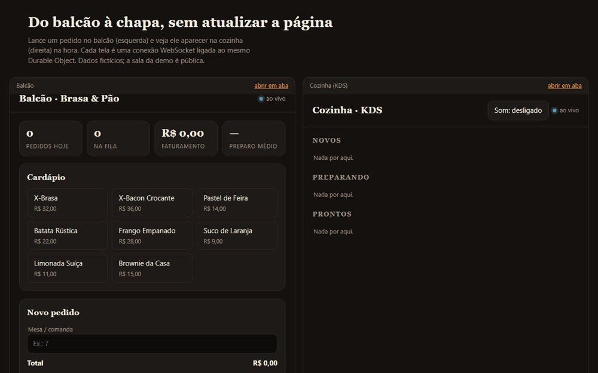

# KDS em tempo real · Real-time Kitchen Display

**Demo / Live:** https://kds-tempo-real.alissondelittig.workers.dev/



## PT

Sistema de pedidos para lanchonete em que o balcão lança a comanda e a **tela da cozinha (KDS)** recebe na hora, sem recarregar a página. Cada tela é um cliente WebSocket ligado ao mesmo **Durable Object**, que guarda os pedidos em SQLite e transmite o estado a todos.

- Balcão: cardápio, comanda por mesa, resumo do dia (pedidos, fila, faturamento, preparo médio).
- Cozinha: colunas Novos → Preparando → Prontos, cronômetro de espera por pedido (fica vermelho após 8 min), destaque visual e bipe opcional a cada pedido novo.
- Uma sala por nome (`?sala=minha-loja`), reconexão automática, validação das mensagens no servidor.
- Dados de exemplo fictícios. A sala `demo` é pública e limitada a 60 pedidos ativos.

**Stack:** TypeScript · Cloudflare Workers · Durable Objects (SQLite + WebSocket Hibernation) · HTML/CSS/JS sem framework.

**Como rodar**

```bash
npm install
npm run dev        # http://127.0.0.1:8787
npm test           # smoke test: dois clientes, pedido, status, resumo (com o dev rodando)
npm run deploy     # plano gratuito do Cloudflare, sem cartão
```

## EN

Order system for a snack bar: the counter sends a ticket and the **kitchen display (KDS)** gets it instantly, no page reload. Every screen is a WebSocket client attached to the same **Durable Object**, which stores orders in SQLite and broadcasts state to everyone.

- Counter: menu, per-table ticket, daily summary (orders, queue, revenue, average prep time).
- Kitchen: New → Preparing → Ready columns, per-order wait timer (turns red after 8 min), visual flash and optional beep on each new order.
- One room per name (`?sala=my-shop`), auto-reconnect, server-side message validation.
- Fictional sample data. The `demo` room is public and capped at 60 active orders.

**Stack:** TypeScript · Cloudflare Workers · Durable Objects (SQLite + WebSocket Hibernation) · framework-free HTML/CSS/JS.

**Run it**

```bash
npm install
npm run dev        # http://127.0.0.1:8787
npm test           # smoke test: two clients, order, status, summary (dev server running)
npm run deploy     # Cloudflare free plan, no card needed
```

## Estrutura / Layout

```
src/index.ts   Worker: roteia /ws para a sala e serve os arquivos estáticos
src/sala.ts    Durable Object: SQLite, regras de status, broadcast
public/        telas: index (demo lado a lado), garcom, cozinha
scripts/       smoke.mjs (teste) · demo_gif.py (gera GIF e capa com Playwright)
```
